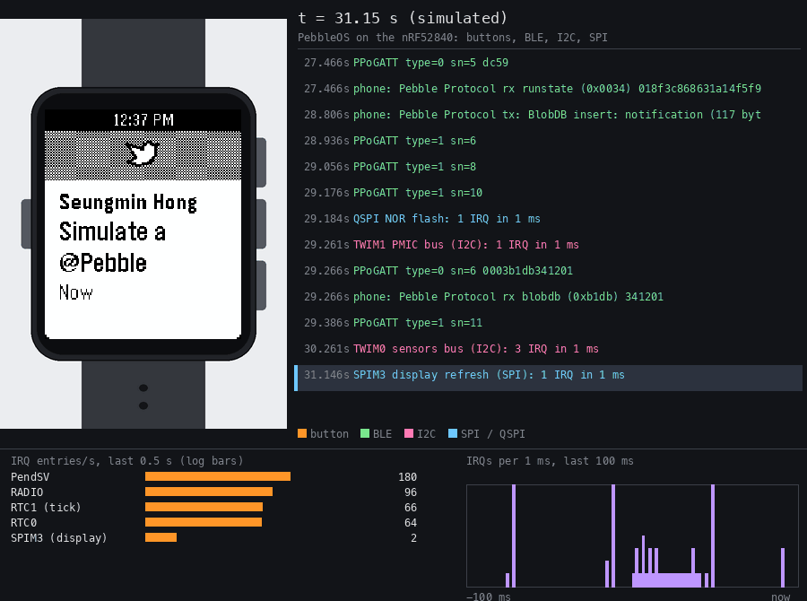
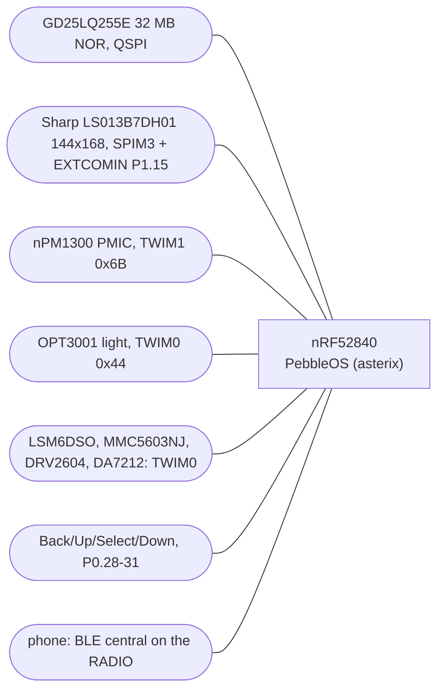

## Run PebbleOS on a simulated Pebble 2 Duo



The same run as an MP4 (432x504, 30 fps): [demo.mp4](docs/screens/demo.mp4). Pixels are the ones the firmware clocks into the Sharp memory LCD, scaled up by nearest neighbour. Frames are shown for the virtual time until the next one; the first-boot filesystem format (0.2 s to 12.6 s, nothing drawn) is cut to 1.5 s.

[PebbleOS](https://github.com/coredevices/PebbleOS) (Apache-2.0), built for the Pebble 2 Duo (board `asterix`, Nordic nRF52840), unmodified, booted by Core Devices' shipping asterix bootloader on pyrite, the Simantic simulator.

| | |
| --- | --- |
| PebbleOS | `coredevices/PebbleOS` @ `ac576058737718d2de0783896789b836ea09757d`, `pbl configure --board asterix && pbl build` |
| Bootloader | `coredevices/PebbleOS-legacy-bootloaders` @ `334bc2f`, `bin/boot/boot_asterix@1753450013.bin` at 0x0 |
| pyrite | `main` at `71982f34859cba04be3b975e40867b6c053f7cbf` (simantic-dev/pyrite#3805, merged) |

```sh
./run.sh    # builds PebbleOS if out/ has no image, runs 34 virtual s (about 25 s wall on an Apple M5), writes out/frames/, the GIF and the MP4
```

**Timeline** (virtual time, one `./run.sh` run). Each button press holds the line low for 150 ms (`buttons` in `sim/overlay.board`).

| Time (s) | What | Image |
| --- | --- | --- |
| 0.098 | bootloader reads the NOR's JEDEC ID 0xC86019, boots the firmware | |
| 0.200 | `*** Booting PebbleOS v9.9.9-dev ***` on UART | |
| 0.27 to 11.7 | first boot: PebbleOS formats its filesystem on the empty NOR | |
| 12.117 | `Valid system resources found!` | |
| 12.398 | `Starting Launcher`; battery service reads 76 %, 3895 mV from the PMIC peer | |
| 12.596 | launcher menu drawn | [png](docs/screens/launcher.png) |
| 12.798 | first BLE ADV_IND on the air: `Pebble 454F`, 16-bit UUID 0xFED9 | |
| 14.0 Back | watch face, 12:00, January 1 (14.392) | [png](docs/screens/watchface.png) |
| 16.0 Select | launcher (16.562) | |
| 17.0, 17.8 Down, 18.6 Up | highlight moves Music, Notifications, Music | [strip](docs/screens/navigation-strip.png) |
| 19.4 Select | Music app (20.038) | [png](docs/screens/music.png) |
| 21.0, 22.0 Back | launcher, then the watch face (22.326) | |
| 23.026 | phone connects; 25.07 numeric comparison, 25.8 Up confirms on the watch; 26.03 paired + encrypted | |
| 26.39 | PPoGATT subscribed and reset handshake; the watch sends its version request (0x11) | |
| 26.51 | phone: version response (Android, run-state capability); the watch logs `Phone app: is_system=1, plf=0x2, capabilities=0x1` | |
| 26.81 | phone: time set 2026-11-19 17:37:00 UTC, offset -300 min; the watch's log clock jumps from 00:00:26 to 17:37:00 | |
| 27.31 | phone: app run state status request (0x34); the watch answers with the running app's UUID (27.47) | |
| 28.81 | phone: BlobDB notification forwarding an X post as the Pebble Android app does (title "Seungmin Hong", body "Simulate a @Pebble", Twitter icon, 12:37 PM); acknowledged at 29.31, drawn at 31.17; the run ends on it | [png](docs/screens/notification.png) |



### What is real and what is simulated

The firmware is real: unmodified PebbleOS, built from source. The hardware around it is simulated:

- **On the chip:** pyrite's shared nRF52840 model (CPU, flash interface, SPI, I2C, timers, radio).
- **Off the chip:** a small Python model per part in `peers/`, wired up in `sim/overlay.board`, following PebbleOS's own board file (`boards/asterix/asterix.dts`).

Each part below says what the model does, and what it leaves out (marked **Not modelled**).

#### Display and storage

**Sharp memory LCD (LS013B7DH01)**: `peers/spi/sharp_memlcd.py`
- Speaks the panel's serial protocol and saves every frame PebbleOS draws as a PNG.

**NOR flash (GD25LQ255E)**: pyrite's shared SPI flash model
- The board's chip ID and size, and GigaDevice status registers.
- **Not modelled:** this part's own erase and program times; it uses the model's generic ones.

#### Sensors

**Accelerometer and gyro (LSM6DSO)**: `peers/i2c/lsm6dso.py`
- Produces samples at the rate the firmware configures, with realistic noise.
- Raises the data-ready interrupt on the board's real pin.
- Full 512-entry FIFO: watermark, overflow and all six modes.
- Wake-up (motion) detection.
- Motion is scripted. By default the watch lies flat and still.
- **Not modelled:** tap, free-fall, orientation, the step counter and low-power modes.

**Magnetometer (MMC5603NJ)**: `peers/i2c/mmc5603nj.py`
- Single and continuous measurements, taking the time the datasheet gives for each setting.
- "Measurement done" flags and the SET/RESET commands.
- **Not modelled:** the magnetic physics behind SET/RESET.

**Light sensor (OPT3001)**: `peers/i2c/opt3001.py`
- Conversions take 100 or 800 ms, as on the real part.
- Like the real part, reading straight after starting a conversion returns the old value. PebbleOS's driver does this.
- **Not modelled:** the threshold interrupt.

#### Power, haptics and audio

**Power management chip (nPM1300)**: `peers/i2c/npm1300.py`
- Battery voltage and current are scripted.
- USB and charger status, and the interrupt line to the CPU.
- Each battery reading takes 250 µs, as on the real part.
- **Caveat:** not checked against Nordic's datasheet (we could not download it). The registers and timings come from the PebbleOS and Zephyr drivers.
- **Not modelled:** battery discharge and the charging state machine.

**Vibration motor driver (DRV2604)**: `peers/i2c/drv2604.py`
- Ignored while its enable pin is low, like the real chip.
- Plays effects and clears its GO bit when done; runs auto-calibration with datasheet timing.
- **Not modelled:** the motor itself and custom waveforms.

**Audio codec (DA7212)**: `peers/i2c/da7212.py`
- Power-up and the clock (PLL) lock status the driver waits for.
- **Not modelled:** sound. The PLL lock time is a stand-in (1 ms), because the datasheet gives none.

#### Buttons and phone

**Buttons**: `peers/gpio/pin_script.py`
- Presses at scripted times.

**Phone**: `peers/ble/phone.py`
- A scripted phone, not the Pebble app, that speaks the same protocol:
  - pairs securely over Bluetooth LE and encrypts the link;
  - opens the Pebble data channel (PPoGATT);
  - does the Pebble app's handshake: version reply, set the time, ask which app is running;
  - sends a notification the way the Pebble Android app forwards an X post (title, text, Twitter icon).
- **Shortcuts:** all values are fixed (time, platform, app version). There is no timeline sync, no app install and no firmware update.

### Open

- **The phone waits 0.5 s after connecting before it pairs (`PAIR_DELAY_US`).** Pairing in the very first connection event hung the watch. This was a simulator bug, not a PebbleOS bug: pyrite modelled 8 interrupt-priority bits for the nRF52840, where the silicon has 3, so the radio interrupt was not masked when it should have been. The fix is simantic-dev/pyrite#3912. Once it is merged, the delay can go.
- Every run is a first boot (the NOR starts erased); dumping the NOR after one run and preloading it would cut the 11 s format.
- `scripts/build_pebbleos.sh` was re-run from a clean checkout on 2026-11-20 with PebbleOS SDK 0.1.16, and that build produced the current demo.

**Needs** Python 3, ffmpeg, and a pyrite `sim` built from main at or after 71982f348 (simantic-dev/pyrite#3805) with `ctx.pair` (not in the 0.10.5 release) (`SIM=/path/to/sim ./run.sh`). Building PebbleOS needs the [PebbleOS SDK](https://github.com/coredevices/PebbleOS-SDK) (`PEBBLEOS_SDK=<install dir>`).

**This repo is a fork of [coredevices/PebbleOS](https://github.com/coredevices/PebbleOS)**, so the firmware the demo runs is the tree you are in. `scripts/build_pebbleos.sh` builds it for the Pebble 2 Duo and fetches the bootloader. `out/` and `build/` are git-ignored. PebbleOS logs are hashed; `scripts/dehash.py` restores them with the build's `log.dict.json`.

Peer tests: `python3 -m pytest peers/tests`. Peer self-check: `python3 peers/ble/phone.py`.
