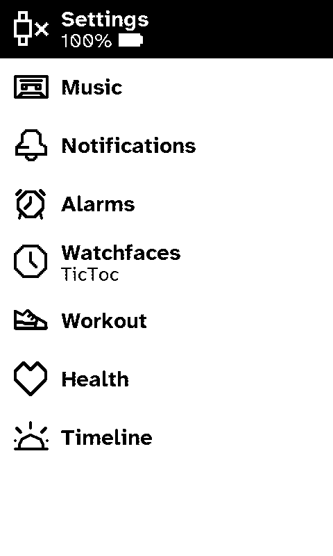

# PebbleOS for the Xteink X4 on Simantic

Unmodified PebbleOS (`xteink_x4`, ESP32-C3) on the Simantic simulator, on the same simulated
reader as our [CrossPoint demo](https://github.com/simantic-dev/crosspoint-reader): SSD1677 panel,
ADC button ladder, 16 MiB flash.

```sh
sim/run.sh ble    # PebbleOS boots to `pebble>` and a second simulated C3 scans its BLE adverts
sim/run.sh live   # interactive: panel + buttons in sim/reader.html over the control port
```

`run.sh` uses `build-xteink_x4/` when you have built it (`pbl build -b build-xteink_x4`),
otherwise it downloads the matching prerelease. It lays out flash the way
`extras/xteink/flash.py` does: firmware at `0x0`, resources at `0x300000`.

Status:
- Boots to the shell in about 0.85 s of simulated time, at real time. Needs pyrite with
  simantic-dev/pyrite#5055 (C3 INTR_STATUS, SARADC DATE and SPI_DATE).
- BLE: advertises as `Pebble XXXX` and the scanner sees it. Pairing to a phone needs a
  Pebble-protocol central peer (not here yet).
- No Wi-Fi: PebbleOS doesn't use it on this reader.
- Panel: draws. `python3 sim/frame2png.py sim/out/epd-*.pbm --transpose` turns the dumps into PNGs.



`scan.elf` is the `openble-scan` image from sim-fixtures.
